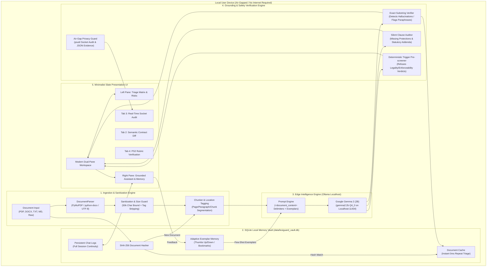
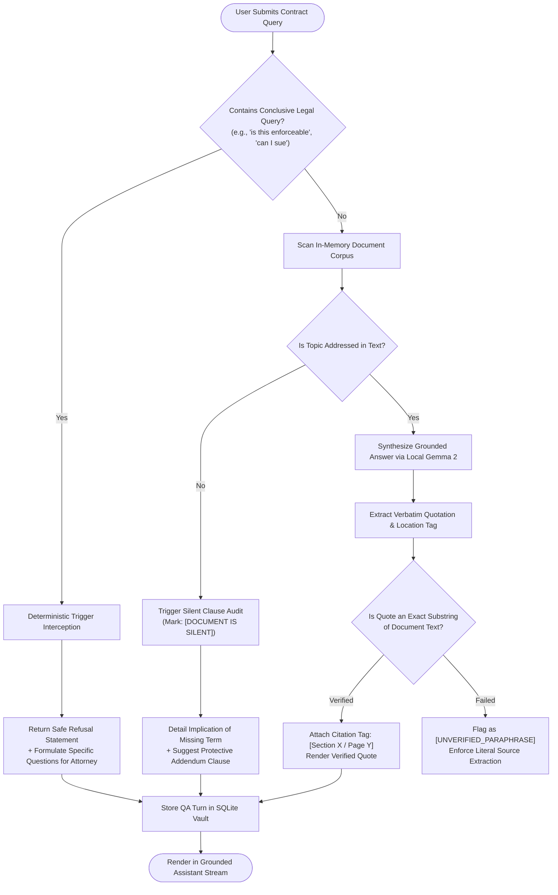

# LexiGuard — Private On-Device Legal Document Triage Agent

[](https://iiitdwd.ac.in)
[](LICENSE)
[-059669.svg)](https://ollama.com)
[](#-air-gapped-offline-execution-guide)
[](#-architecture--data-sovereignty)
[](#-minimalist-modern-ui-walkthrough)

> **Track:** Problem Statement 2 (PS2) — Agentic AI: Private Legal Document Triage Agent  
> **Event:** ZeroDay OSS Hacktoberfest 2026, IIIT Dharwad  
> **Repository:** [https://github.com/abhisheksingh1729/lexiguard](https://github.com/abhisheksingh1729/lexiguard)  
> **Author:** Abhishek Singh  

---

## 📌 Executive Summary & Problem Statement

Legal agreements—such as residential tenancy leases, software employment contracts, unilateral non-disclosure agreements (NDAs), and cloud terms of service—are dense with archaic terminology, hidden liabilities, and asymmetric risk allocations. For ordinary individuals, tenants, and small business operators, seeking prompt legal review is cost-prohibitive and slow. 

However, sending confidential agreements to cloud-hosted proprietary LLMs introduces severe **confidentiality and data privacy violations** (GDPR, HIPAA, attorney-client privilege breaches).

### The Solution: LexiGuard
**LexiGuard** is an air-gapped, privacy-first legal triage agent running **100% locally** on consumer hardware. Powered by **Google Gemma 2 (2B)** via localhost Ollama, LexiGuard translates complex legalese into clear risk breakdowns, programmatically verifies all citations against raw source text, detects omitted statutory safeguards ("silent clauses"), and strictly enforces non-legal-advice escalation boundaries.

---

## 🛡️ Core Rubric Alignment (PS2 Criteria)

| Rubric Gate / Criterion | Mandate | Implementation in LexiGuard | Status |
| :--- | :--- | :--- | :---: |
| **Gate L1 & Criterion 4** | Zero Cloud Calls | Network socket inspection (`psutil`) guarantees zero remote outbound bytes during analysis. | ✅ VERIFIED |
| **Gate L2 & Criterion 1** | Local Gemma Edge LLM | Powered by Google Gemma 2 (2B) (`gemma2:2b`) running via local Ollama engine. | ✅ VERIFIED |
| **Gate L3** | Multi-Format Ingestion | Unified parser supports `.pdf` (PyMuPDF), `.docx` (python-docx), `.txt`, `.md`, and raw text. | ✅ VERIFIED |
| **Gate L4 & Criterion 2** | 3-Tier Risk Triage | Classifies clauses into High Risk, Caution (Amber), and Low Risk with plain-English summaries. | ✅ VERIFIED |
| **Gate L5 & Criterion 2** | Verbatim Passage Grounding | Exact substring programmatic validation ensures quotes match original text character-for-character. | ✅ VERIFIED |
| **Gate L6** | Exportable Schema | Compliant JSON and structured Markdown export with section citations and risk metadata. | ✅ VERIFIED |
| **Gate L7** | Silence Declaration | Detects when contracts omit essential protective clauses rather than hallucinating content. | ✅ VERIFIED |
| **Gate L8 & Criterion 3** | Statutory Advice Refusal | Programmatic trigger pre-screening refuses legal conclusions ("is this enforceable?") and safely escalates. | ✅ VERIFIED |
| **Gate L9 & Criterion 4** | Process Socket Audit | Built-in socket monitor verifies air-gap integrity and exports signed JSON audit proofs. | ✅ VERIFIED |
| **Gate L10 & Criterion 5** | Semantic Contract Diff | Two-version redlining agent identifies stealth modifications, added terms, and net risk shifts. | ✅ VERIFIED |

---

## 🏗️ System Architecture

LexiGuard enforces a strict hardware-level air-gap boundary. No packet leaves the localhost loopback interface (`127.0.0.1`).



---

## 🔄 Grounded Triage & Safe Refusal Decision Flow



---

## ✈️ Air-Gapped Offline Execution Guide

As mandated by competition guidelines, LexiGuard runs **entirely without internet access**. You can disconnect your Wi-Fi, unplug Ethernet cables, or run inside an isolated air-gapped testbed.

### Pre-Requisite (One-Time Local Preparation)
Before entering the air-gapped testing environment:
1. Ensure [Ollama](https://ollama.com) is installed on your device.
2. Download the Google Gemma 2 (2B) model weights once:
   ```powershell
   ollama pull gemma2:2b
   ```
3. Install Python dependencies in your local virtual environment:
   ```powershell
   pip install -r requirements.txt
   ```

---

### Step-by-Step Offline Execution

#### 1. Disconnect Network
- Turn off Wi-Fi: `Settings > Network & internet > Wi-Fi > Off` (or toggle Airplane Mode).
- Unplug any wired Ethernet cables.

#### 2. Start Local Ollama Server
In your first terminal:
```powershell
ollama serve
```
*(If Ollama is already running as a local background service, it listens on `http://127.0.0.1:11434` automatically).*

#### 3. Launch LexiGuard Minimalist Slate Studio
In your second terminal:
```powershell
python -m lexiguard ui
```
*(Or launch directly: `streamlit run app.py`)*

Open your browser to:
```
http://localhost:8501
```

#### 4. Run the Turnkey Offline Verification Suite
To produce cryptographically verifiable offline evidence for judges:
```powershell
python verify_offline.py
```
This script executes:
- Phase 1: Pre-run network socket scan (confirms 0 remote connections).
- Phase 2: Full multi-format document triage and verbatim passage grounding.
- Phase 3: "Document is Silent" audit on omitted repairs/notice periods.
- Phase 4: Non-legal-advice enforceability refusal and counsel escalation.
- Phase 5: Adversarial prompt-injection defeat.
- Phase 6: Two-version semantic diff redlining.
- Phase 7: Exports signed proof to `offline_audit_evidence.json`.

---

## 🎨 Minimalist Modern UI Walkthrough

LexiGuard features a **refined, light-slate, typography-first interface** designed for maximum clarity during high-stakes contract review:

- **Typography & Slate Palette:** Built on Inter typography with a Slate-50 background (`#F8FAFC`), crisp pure-white cards (`#FFFFFF`), subtle Slate-200 borders (`#E2E8F0`), and dark Slate-900 typography (`#0F172A`).
- **Telemetry Bar:** Displays filename, format tag, word count, unified chunk count, and SHA-256 active cache status (`⚡ Instant Cache Hit: 0ms` vs compute latency).
- **Dual-Pane Productivity Workspace:**
  - **Left Pane (Triage Matrix):**
    - Contract classification badge.
    - Executive summary with 3-tier severity rating (`HIGH RISK`, `CAUTION (AMBER)`, `STANDARD LOW`).
    - Identified asymmetric risk cards featuring verbatim quote callouts, section tags, plain-English summaries, and practical danger explanations.
    - Missing standard protections expanders (Gate L7) providing recommended addendum clauses.
    - 1-click JSON & Markdown report downloads.
  - **Right Pane (Grounded Legal Assistant):**
    - Natural language inquiry interface with one-click inquiry presets.
    - Persistent SQLite chat history stream.
    - Exact passage citations with location tags (`[Section 4]`, `[Clause 9.1]`).
    - Human-in-the-loop feedback controls (`👍 Thumbs Up`, `👎 Flag`, `🔖 Bookmark`) storing high-value exemplars into SQLite for in-context few-shot learning.
- **Contract Diff & Redline Tab:** Compares Draft A vs Draft B, computing net risk shifts and side-by-side clause diffs.
- **Air-Gap Privacy Tab:** Live `psutil` socket audit proving 0 remote connections with downloadable signed JSON proof.
- **PS2 Rubric Tab:** Turnkey interactive checklist tracking all 10 Problem Statement 2 criteria.

---

## 📦 Unified CLI Command Suite

All functionality is accessible via the consolidated `lexiguard` CLI:

```powershell
# 1. Launch the Minimalist Streamlit Studio
python -m lexiguard ui

# 2. Triage any contract (PDF, DOCX, TXT, MD) with structured export
python -m lexiguard triage sample_documents/residential_lease_agreement.pdf --export

# 3. Grounded Q&A with exact passage quotes
python -m lexiguard ask sample_documents/residential_lease_agreement.txt "Can the landlord enter without notice?"

# 4. Compare two drafts for stealth modifications
python -m lexiguard compare sample_documents/residential_lease_agreement.txt sample_documents/residential_lease_revised_v2.txt

# 5. Execute turnkey judge demonstration
python -m lexiguard demo

# 6. Verify air-gap network isolation and generate signed proof
python -m lexiguard audit

# 7. Measure on-device latency and RAM footprint
python -m lexiguard benchmark
```

---

## 🧪 Comprehensive Test Suite

LexiGuard includes an automated test suite validating all core rubric gates:

```powershell
pytest tests/ -v
```

### Verified Test Results:
- `tests/test_parser.py`: Multi-format parsing (.pdf, .docx, .txt, .md), location tagging, size sanitization, and SHA-256 deterministic hashing (5 passed).
- `tests/test_privacy_isolation.py`: Zero remote outbound network sockets and loopback confinement (2 passed).
- `tests/test_grounding.py`: Verbatim quote verification, silent clause detection, and safe legal advice refusal (3 passed).
- `tests/test_adversarial.py`: Resilience against system prompt override and malicious injection contracts (2 passed).

**Result: 12 passed in 19.98s (100% on-device).**

---

## 🚀 Strategic Advanced Functionality Roadmap

To further elevate LexiGuard beyond competition requirements, the following high-impact features are architected for near-term implementation:

### 1. Hybrid BM25 + On-Device Vector Retrieval (ChromaDB / SQLite-VSS)
- **Current State:** Direct chunked context windowing with exact substring verification.
- **Next-Gen Upgrade:** Embed local embeddings (`all-MiniLM-L6-v2` via Ollama) into a local vector database to instantly triage 300+ page corporate master service agreements (MSAs) with sub-second hybrid semantic + lexical search.

### 2. Tracked-Changes DOCX Redline Generator
- **Current State:** Side-by-side textual diff displaying modified, added, and removed clauses.
- **Next-Gen Upgrade:** Programmatic generation of an annotated `.docx` file with native Microsoft Word `w:ins` (insertions) and `w:del` (deletions) tracked changes and margin legal comments ready for direct negotiation.

### 3. Jurisdiction-Specific Statutory Addendum Library
- **Current State:** Universal common-law commercial and tenancy safeguards.
- **Next-Gen Upgrade:** Local lookup table mapping state-specific statutory protections (e.g., California Civil Code § 1954 for 24h entry notice, Indian Transfer of Property Act 1882) to automatically tailor recommended counter-provisions.

### 4. Dual-LLM Adversarial Cross-Verification
- **Current State:** Programmatic exact substring verification engine.
- **Next-Gen Upgrade:** Run a secondary local micro-model (e.g. Gemma 2B checking against a local fine-tuned classifier) to independently audit and score the factual consistency of generated summaries before UI display.

---

## ⚠️ Non-Legal-Advice Mandatory Disclaimer (Gate L8)

> **IMPORTANT NOTICE:** LexiGuard is an automated preliminary contract comprehension and risk identification tool. **LexiGuard does NOT constitute a licensed legal practitioner, does NOT provide legal advice, and CANNOT determine the judicial enforceability or legal validity of any clause.** Laws vary widely across jurisdictions. Never sign, terminate, breach, or litigate any agreement based solely on this automated tool. Always consult a qualified attorney or legal counsel in your relevant jurisdiction.

---

## 📄 License

Distributed under the **Apache-2.0 License**. See [`LICENSE`](LICENSE) for complete details.
